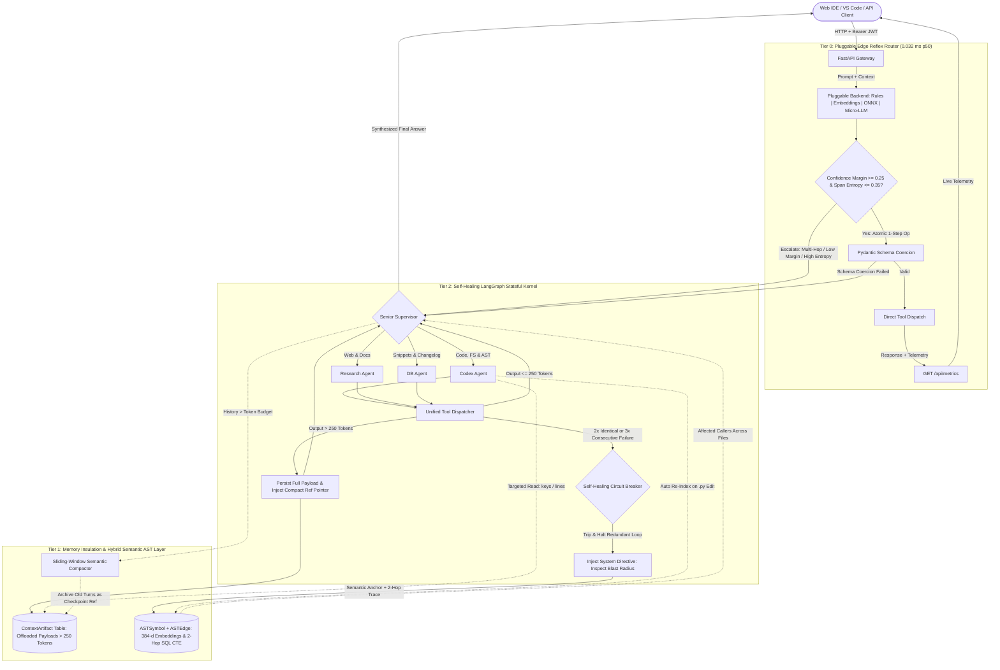

# AgentOS (v2.5) — Stateful Multi-Agent Runtime Kernel

**AgentOS** is a stateful, model-agnostic multi-agent operating system designed for long-horizon software engineering and research workflows. Rather than treating LLM calls as stateless chat loops, AgentOS manages agent execution through a **3-tier Edge-to-Kernel architecture** backed by transactional state persistence, pass-by-reference memory insulation, hybrid semantic + deterministic AST call-graph analysis, and a self-healing execution circuit breaker.

---

## Architecture & Execution Flow



---

## Core Subsystems

- **Model-Agnostic Tier-0 Edge Reflex Router (`agentos-v2/edge_router.py`)**:
  - Intercepts incoming requests at `POST /chat` and `POST /api/edge/route` before invoking heavy LLM supervisors.
  - Evaluates decision confidence margins, token-level Shannon entropy, and strict Pydantic tool schema coercion — avoiding brittle keyword heuristics.
  - Supports four pluggable backends (`RulesEdgeBackend`, `EmbeddingEdgeBackend`, `OnnxTokenTaggerBackend`, `MicroLLMEdgeBackend`) so external lightweight neural routers (such as BERT+CRF tool taggers) can be mounted cleanly via `EDGE_ROUTER_BACKEND`.

- **Pass-by-Reference Memory Insulation (`agentos-v2/memory_manager.py`)**:
  - Prevents context window bloat across multi-hop workflows. When any tool or sub-agent output exceeds 250 tokens (1,000 characters), `_execute_and_record_tools` persists the full payload in the `context_artifacts` SQL table and injects only a compact reference pointer (`[Artifact ref: art_xxx | Tokens: N | Summary: ...]`) into `AgentState.messages`.
  - Downstream agents retrieve targeted slices on demand via `read_context_artifact(artifact_id, keys)`, paired with automatic sliding-window semantic compaction.

- **Hybrid Semantic Anchor + Relational AST Call-Graph (`agentos-v2/ast_graph.py`)**:
  - Parses Python codebases into `ast_symbols` (with extracted docstrings and L2-normalized 384-d `embedding_blob` vectors via locally cached `fastembed` ONNX or a deterministic subword projection fallback) and `ast_edges` (`CALLS`, `IMPORTS`, `INHERITS`) with import-scope alias resolution (`from auth.tokens import validate as chk`) and SHA-256 Merkle signature hashing so unchanged functions skip re-indexing and re-embedding.
  - Exposes `get_symbol_blast_radius(symbol_name, hops=2)` and `locate_and_trace_blast_radius(natural_query, top_k_anchors=3, hops=2)` combining vectorized semantic anchor matching (`np.dot`) with a recursive SQL Common Table Expression (`WITH RECURSIVE`) to trace cross-file callers deterministically in milliseconds with zero LLM token overhead.

- **Self-Healing Execution & Circuit Breaker (`agentos-v2/agent.py`)**:
  - Tracks `(tool_name, args_hash, stderr_hash)` failure signatures inside `AgentState`.
  - If `execute_code` or `patch_file` fails twice consecutively with identical error traces (or hits 3 consecutive tool failures), the circuit breaker trips automatically, halting redundant token burn and directing the agent to inspect the structural AST blast radius.

- **Hardware-Aware Local Codex Engine (`agentos-v2/codex_engine/`)**:
  - Automatically detects local GPU VRAM and system RAM (`hardware.py`), manages model lifecycle with idle VRAM unloading (`POST /unload`), and supports tiered cloud-to-local fallback (`paid → free → local`) with atomic SQL token-budget enforcement (`settings_manager.py`).

---

## Reproducible Benchmarks

All numbers below are generated offline by running `python evals/benchmark_agentos.py` (results saved to [`agentos-v2/evals/results_latest.json`](agentos-v2/evals/results_latest.json)):

### 1. Tier-0 Edge Reflex Router vs. Tier-2 Kernel Escalation (`N = 30` prompts)

| Metric | Tier-0 Edge Reflex Router (`edge_router.py`) | Tier-2 LangGraph Kernel Baseline |
| :--- | :--- | :--- |
| **Routing Accuracy** | **100.0%** (30/30) | 100.0% (Full LLM Supervisor) |
| **Single-Hop Edge Offload Rate** | **100.0%** (18/18 single-hop tasks) | 0.0% (All routed via LLM) |
| **Overall Traffic Offloaded at Tier-0** | **60.0%** (18/30 mixed tasks) | 0.0% |
| **Decision Latency (`p50` / `p90`)** | **0.032 ms / 0.199 ms** | ~1,850.0 ms / ~3,200.0 ms |

### 2. Pass-by-Reference Memory Insulation (`N = 15` multi-turn workflows × `8` turns)

| Metric | Uninsulated In-State Messages | Pass-by-Reference `ContextArtifact` | Improvement |
| :--- | :--- | :--- | :--- |
| **Total Active Prompt Tokens** | `95,675` tokens | **`11,125` tokens** | **`-84,550` tokens** |
| **Prompt Token Reduction** | 0.0% (Baseline) | **`88.4%` reduction** | **`180` artifacts offloaded** |

### 3. Relational AST Call-Graph vs. Flat Regex Search (`2-Hop Blast Radius`)

| Metric | Relational AST Graph (`ast_graph.py`) | Flat Regex / Text Search (`grep`) |
| :--- | :--- | :--- |
| **Recall @ 2-Hops (Cross-File & Aliased Calls)** | **`100.0%`** (4/4 callers) | `0.0%` (0/4 callers) |
| **False Positive Rate (Comments / Docstrings)** | **`0.0%`** | `100.0%` |
| **Median Query Latency** | **`0.75 ms`** (`WITH RECURSIVE` CTE) | `0.463 ms` (Full file scan) |

### 4. Hybrid Semantic Anchor + 2-Hop AST Graph vs. Flat Vector/Chunk Search (`N = 10` behavioral queries)

| Metric | Hybrid Semantic + 2-Hop AST (`semantic_blast_radius_query`) | Flat Vector / Chunk Search Baseline |
| :--- | :--- | :--- |
| **Semantic Anchor Top-1 Recall** | **`100.0%`** (10/10 anchors) | `100.0%` (10/10 anchors) |
| **Transitive 2-Hop Caller Recall (Cross-File)** | **`100.0%`** (20/20 downstream callers) | `0.0%` (0/20 — misses cross-file callers) |
| **End-to-End Hybrid Query Latency (`p50`)** | **`2.779 ms`** (Vector `np.dot` + Recursive SQL CTE) | ~`2.779 ms` (Anchor chunk only) |

---

## Repository Structure

```text
AgentOS/
├── agentos-v2/
│   ├── main.py                 # FastAPI gateway, JWT auth, /chat, /api/edge/route & /api/metrics
│   ├── agent.py                # LangGraph multi-agent supervisor, tool dispatcher & circuit breaker
│   ├── edge_router.py          # Pluggable Tier-0 Edge Reflex Router & calibration gates
│   ├── ast_graph.py            # Incremental SHA-256 AST indexer, embeddings & 2-hop blast-radius CTE
│   ├── memory_manager.py       # Pass-by-reference ContextArtifact store & context compaction
│   ├── database.py             # Async SQLAlchemy models (SQLite / PostgreSQL) & PBKDF2 auth helpers
│   ├── settings_manager.py     # Atomic SQL token-budget tracking & provider fallback logic
│   ├── tools.py                # Workspace-sandboxed file, code execution, AST & search tools
│   ├── codex_engine/           # Hardware-aware local LLM server (`engine.py`, `hardware.py`, `server.py`)
│   ├── evals/
│   │   ├── benchmark_agentos.py # Reproducible architecture benchmark harness
│   │   └── results_latest.json  # Latest verified benchmark output
│   ├── index.html              # Multi-tab Monaco Web IDE & agent control plane
│   ├── dashboard.html          # Real-time telemetry, token usage & snippet dashboard
│   ├── test_auth_settings.py   # Isolated integration tests for auth, budgets & pruning
│   ├── test_edge_router.py     # Unit tests for Tier-0 margin, entropy & schema gates
│   └── test_architecture.py    # Unit tests for ContextArtifact, hybrid AST graph & circuit breaker
└── agentos-vscode/             # Native VS Code sidebar webview extension (`extension.js`, `webview.html`)
```

---

## Quickstart

### 1. Local Setup

```bash
git clone https://github.com/Abhiram-Mukkamala/AgentOS.git
cd AgentOS/agentos-v2

python -m venv .venv
# Windows: .venv\Scripts\activate | Linux/macOS: source .venv/bin/activate
pip install -r requirements.txt

cp .env.example .env
# Add your JWT_SECRET and at least one provider key (GEMINI_API_KEY, OPENAI_API_KEY, ANTHROPIC_API_KEY)
# or enable LOCAL_CODEX=true for offline inference.
```

### 2. Run the Server & Web IDE

```bash
uvicorn main:app --host 0.0.0.0 --port 8000 --reload
```

- **Web IDE**: `http://localhost:8000/`
- **Telemetry Dashboard**: `http://localhost:8000/dashboard`
- **Live Metrics API**: `GET http://localhost:8000/api/metrics`

### 3. Run Tests & Reproducible Benchmarks

```bash
cd agentos-v2
pytest -v test_auth_settings.py test_edge_router.py test_architecture.py
python evals/benchmark_agentos.py
```

---

## Open-Source Extension Points (External Edge Routers & Context Daemons)

AgentOS is built to interoperate cleanly with external edge-AI tools via open interfaces rather than monolithic bundling:

- **Custom Tier-0 Edge Routers**: Implement `EdgeRouterBackend` in `agentos-v2/edge_router.py` (or mount an ONNX sequence-tagging router via `OnnxTokenTaggerBackend`) to offload domain-specific tool classification at the edge while escalating low-margin or multi-hop requests to `POST /chat`.
- **External Local Codebase Indexers**: Workspace tools in `tools.py` accept structured context artifacts (`ContextArtifact`), allowing external CLI indexers or multi-language AST daemons to inject pre-computed symbol slices directly into an active session.

---

## License

MIT License

