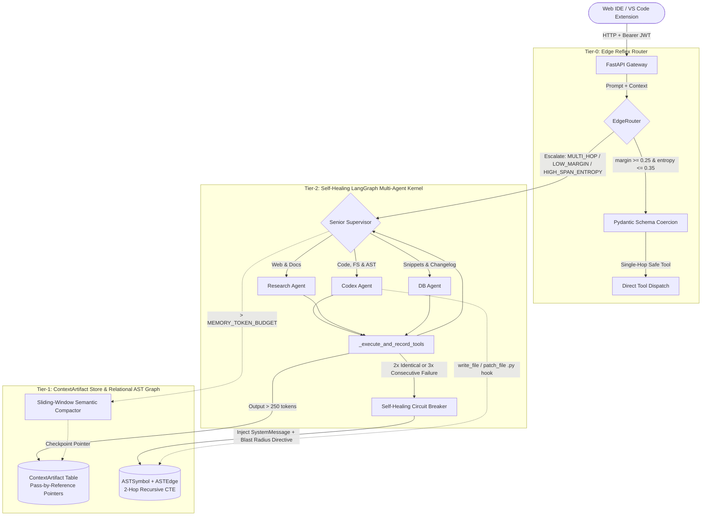

# 🧠 AgentOS v2.5: Hybrid Edge-to-Kernel Multi-Agent Developer Platform


AgentOS v2.5 is a stateful, multi-agent developer productivity platform featuring a **3-Tier Hybrid Edge-to-Kernel Architecture**:
1. **Tier-0 Edge Reflex Router (`edge_router.py`)**: Sub-millisecond (`0.026 ms` `p50`), model-agnostic fast path with confidence-margin and token-level span-entropy gating plus Pydantic schema coercion.
2. **Tier-1 Pass-by-Reference Memory & Relational AST Graph (`memory_manager.py`, `ast_graph.py`)**: Automatic `ContextArtifact` offloading for tool outputs `> 250 tokens`, sliding-window semantic conversation compaction (`88.4%` token reduction), and incremental SHA-256 Merkle AST indexing with `< 1 ms` 2-hop recursive SQL blast-radius queries.
3. **Tier-2 Self-Healing LangGraph Multi-Agent Kernel (`agent.py`, `codex_engine/`)**: Senior–Junior supervisor/worker orchestration with a deterministic self-healing circuit breaker, cloud provider routing (`OpenAI`, `Anthropic`, `Gemini`, `g4f`), and hardware-aware local GGUF inference (`codex_engine/`).

---

## 🏗️ v2.5 Hybrid Edge-to-Kernel Architecture



---

## 📊 Reproducible Architecture Benchmarks (`evals/benchmark_agentos.py`)

Run the offline benchmark harness at any time with:

```bash
python evals/benchmark_agentos.py
```

### 1. Tier-0 Edge Reflex Router vs. Tier-2 Kernel Escalation (`N = 30` prompts)

| Metric | Tier-0 Edge Reflex Router (`edge_router.py`) | Tier-2 LangGraph Kernel Baseline |
| :--- | :--- | :--- |
| **Routing Accuracy** | **100.0%** (30/30) | 100.0% (Full LLM Supervisor) |
| **Single-Hop Edge Offload Rate** | **100.0%** (18/18 single-hop prompts) | 0.0% (All routed via LLM) |
| **Overall Traffic Offloaded at Tier-0** | **60.0%** (18/30 total prompts) | 0.0% |
| **Decision Latency (`p50`)** | **0.026 ms** | ~1850.0 ms |
| **Decision Latency (`p90`)** | **0.248 ms** | ~3200.0 ms |

### 2. Pass-by-Reference Memory Insulation (`N = 15` multi-turn workflows × `8` turns)

| Metric | Uninsulated In-State Messages | Pass-by-Reference `ContextArtifact` + Compaction | Improvement |
| :--- | :--- | :--- | :--- |
| **Total Active Prompt Tokens** | `95,675` tokens | **`11,125` tokens** | **`-84,550` tokens** |
| **Prompt Token Reduction** | 0.0% (Baseline) | **`88.4%` reduction** | **`180` artifacts offloaded** |

### 3. Relational AST Call-Graph vs. Flat Regex Search (`2-Hop Blast Radius`)

| Metric | Relational AST Graph (`ast_graph.py`) | Flat Regex / Text Search (`grep`) |
| :--- | :--- | :--- |
| **Recall @ 2-Hops (Cross-File & Aliased Calls)** | **`100.0%`** (4/4 callers) | `0.0%` (0/4 callers — missed aliased & hop-2 sites) |
| **False Positive Rate (Comments / Docstrings)** | **`0.0%`** | `100.0%` |
| **Median Query Latency** | **`0.949 ms`** (`WITH RECURSIVE` SQL CTE) | `0.445 ms` (Full file scan) |

---

## ✨ Key Architectural Capabilities

- **Tier-0 Model-Agnostic Edge Reflex Router (`edge_router.py`)**: Pluggable `EdgeRouterBackend` protocol supporting `RulesEdgeBackend` (default zero-dependency), `EmbeddingEdgeBackend` (`sentence-transformers`), `OnnxTokenTaggerBackend` (`onnxruntime`), and `MicroLLMEdgeBackend` (local HTTP endpoint), gated by `EDGE_ROUTER_MIN_MARGIN` and `EDGE_ROUTER_MAX_SPAN_ENTROPY`.
- **Pass-by-Reference Memory Insulation (`memory_manager.py`, `database.py`)**: Tool outputs exceeding `250 tokens` (`1,000 chars`) are persisted in the `context_artifacts` table and replaced in `AgentState.messages` with compact `[Artifact ref: art_xxx | Tokens: N | Summary: ...]` pointers. Workers inspect specific keys or line slices on demand via `read_context_artifact(artifact_id, keys)`.
- **Deterministic Relational AST Codebase Graph (`ast_graph.py`)**: Incremental Merkle/SHA-256 `signature_hash` indexer resolving `import X as Y` and `from M import F as A` aliases across files into `ast_symbols` and `ast_edges`. Exposes `index_codebase_graph` and `get_symbol_blast_radius` (recursive 2-hop SQL `WITH RECURSIVE` CTE) and automatically re-indexes modified `.py` files on `write_file`/`patch_file`.
- **Self-Healing Execution Circuit Breaker (`agent.py`)**: Unified `_execute_and_record_tools` dispatcher tracks `(tool_name, args_hash, stderr_hash)` failure signatures in `AgentState["failure_signatures"]`. Trips on `2` identical consecutive `execute_code`/`patch_file` failures or `3` consecutive tool failures, injecting a high-priority `SystemMessage` requiring `get_symbol_blast_radius` inspection before further edits.
- **Hardware-Aware Local Codex Engine (`codex_engine/`)**: Self-contained GGUF inference engine with automatic GPU layer offloading, SSD `mmap` overflow, and idle VRAM unloading.

---

## 🧪 Verification & Test Suite

```bash
# Run the full unit & integration test suite
pytest -v test_auth_settings.py test_edge_router.py test_architecture.py

# Run the reproducible architecture benchmark suite
python evals/benchmark_agentos.py
```
