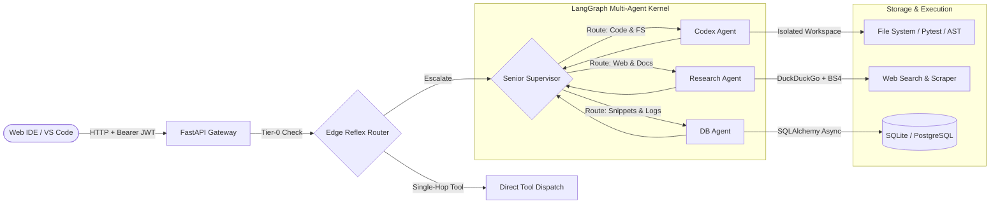

# 🧠 AgentOS v2: Hybrid Edge-to-Kernel Multi-Agent Developer Platform

AgentOS v2 is a stateful, multi-agent developer productivity platform combining a **Tier-0 Edge Reflex Router** with a **Senior–Junior LangGraph Kernel**, persistent workspace tools, a browser-based Monaco IDE, an analytics dashboard, and a self-contained local GGUF inference engine (**Codex Engine**).

## 🏗️ Architecture Flow

## ✨ Key Capabilities

- **Tier-0 Edge Reflex Router (`edge_router.py`)**: Model-agnostic fast path supporting deterministic rules, local embeddings, ONNX token taggers, or micro-LLMs with margin & span-entropy gating before escalating to the LangGraph kernel.
- **Senior–Junior Model Hierarchy (`agent.py`)**: Configurable cloud providers (`OPENAI_MODEL`, `ANTHROPIC_MODEL`, `GEMINI_MODEL`, `SENIOR_MODEL_PROVIDER`), free web fallback (`g4f`), and local GGUF inference (`codex_engine/`).
- **Per-User Auth, Token Budgets & Context Pruning (`database.py`, `settings_manager.py`)**: PBKDF2-HMAC-SHA256 authentication, atomic SQL token budget tracking with automatic local fallback, and LangGraph checkpoint pruning.
- **Self-Contained Local Codex Engine (`codex_engine/`)**: Hardware-aware (`hardware.py`) GGUF model loader with GPU layer offloading, SSD `mmap` overflow, and idle VRAM unloading.
